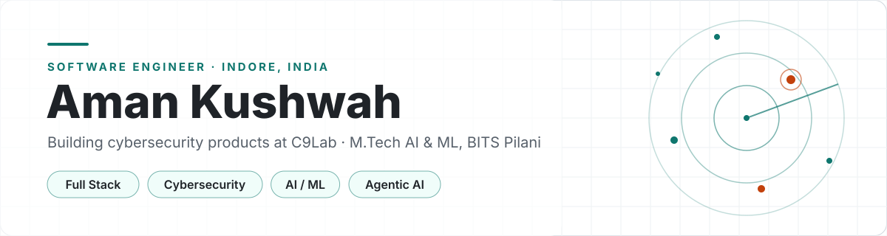

<picture>
  <source media="(prefers-color-scheme: dark)" srcset="assets/banner-dark.svg">
  
</picture>

  
  
  

## About

**Assistant Product Manager** with **3+ years** across software engineering, cybersecurity products and applied machine learning.

- At **C9Lab (Pinak Infosec Pvt Ltd)** I own cybersecurity products from requirements to release, and still build them hands on.
- I am pursuing an **M.Tech in Artificial Intelligence and Machine Learning at BITS Pilani**. My dissertation predicts which lookalike domains of a brand will turn into live phishing sites, with risk scores analysts can trust.
- I like turning messy, manual work into dependable systems, from payment flows to AI agent pipelines.

## Experience

**Assistant Product Manager** · C9Lab (Pinak Infosec Pvt Ltd), Indore · *Mar 2024 – Present* (joined as Software Engineer)

*Product*

- Own the release cycle: versioning, release notes, staging reviews, defect triage and production deployment plans.
- Write product requirements, technical specifications and user guides, and track feature delivery.
- Benchmarked our platform against 80+ digital risk vendors (battlecards, SWOT, gap analysis) to shape the roadmap.
- Shape packaging and go-to-market: plan tiers, proposals, partner programmes, and partner training and enablement.
- Lead pre-sales demos and support client onboarding.

*Engineering and team*

- Build and maintain cybersecurity products for brand protection and digital risk, phishing simulation, website monitoring and secure remote access, across a React frontend and a Django backend.
- Run security testing with Burp Suite and OWASP ZAP to find and fix vulnerabilities.
- Run stand-ups, sprint planning and code reviews; mentor interns and junior developers on React and security basics.

**Software Engineer** · Tech Radix Pvt Ltd, Indore · *Feb 2023 – Feb 2024*

- Built full stack e-commerce and fintech applications with React, Node.js and Python Django.
- Integrated payment gateways: Stripe, Razorpay, Paytm and Chargebee.
- Integrated REST and third party APIs with cross functional teams.

## Tech stack

| Area | |
|---|---|
| Languages |     |
| Frontend |     |
| Backend |      |
| AI and ML |        |
| Data |     |
| DevOps |      |
| Security |     |
| Payments |     |

## Projects

**AI and machine learning**

| Project | What it does |
|---|---|
| [DesiQuip](https://github.com/amankushwah555/DesiQuip) | AI agent pipeline that plans, writes, produces and publishes Hindi YouTube Shorts; the owner only approves or rejects each video. Python, Claude Code agents, Remotion |
| Vulnerability exploitation prediction | Predicts which CVEs are likely to be exploited, from NVD and CISA KEV data, with Random Forest and XGBoost, TF-IDF features and SMOTE for class imbalance |
| Healthcare NLP | Part of speech tagging and named entity recognition on patient drug reviews with NLTK and spaCy, extracting drugs and conditions |
| Lookalike domain early warning *(M.Tech dissertation, in progress)* | Finds real brand lookalike domains and predicts which will go live as phishing sites, with calibrated risk scores |

**Full stack**

| Project | What it does |
|---|---|
| [FinEdge](https://github.com/amankushwah555/finedge) | REST API for personal income, expenses and budgets, with monthly summaries and auto categorisation. Node.js, Express, JWT |
| [Virtual Event Management Platform](https://github.com/amankushwah555/Virtual-Event-Management-Platform) | Backend for virtual events: auth, organiser and attendee roles, event management and registration emails. Node.js, Express, Jest |
| CryptoPad | Crypto portfolio and tax management with Chargebee subscriptions, Vezgo API and social login |
| Afforo | Online grocery platform: React Native apps for customers and delivery riders, Django admin |
| Society Management System | Visitors, complaints, notices, maintenance billing and resident communication. React, Node.js |

## Education

| | |
|---|---|
| **M.Tech, Artificial Intelligence and Machine Learning** · BITS Pilani (WILP) | 2025 – Present |
| **B.Tech, Computer Science and Engineering** · Chameli Devi Group of Institutions, Indore · CGPA 8.3 | 2019 – 2023 |

---

Open to conversations on cybersecurity products, applied ML and AI agents. The quickest way to reach me is [LinkedIn](https://www.linkedin.com/in/amankushwah555/).
